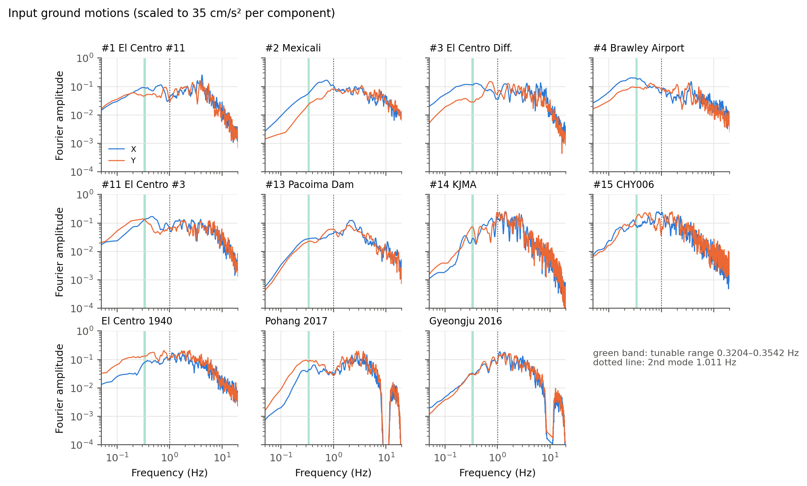
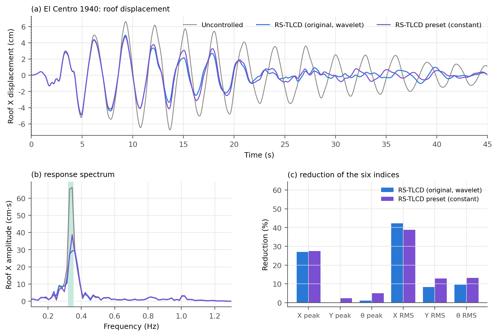
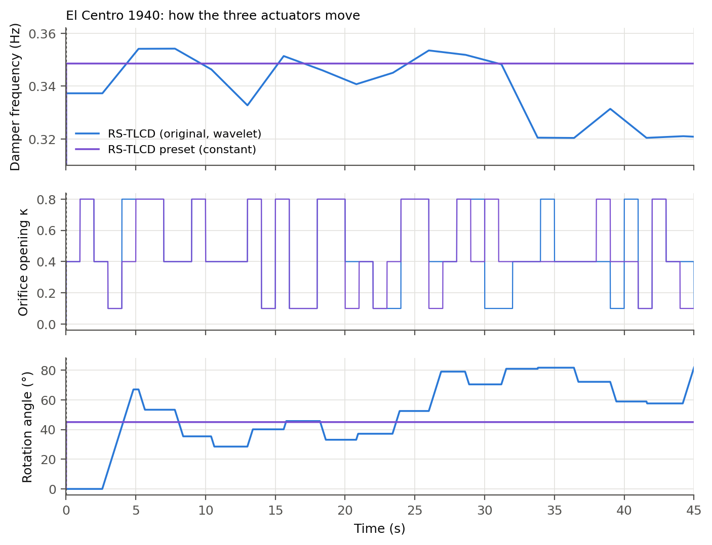
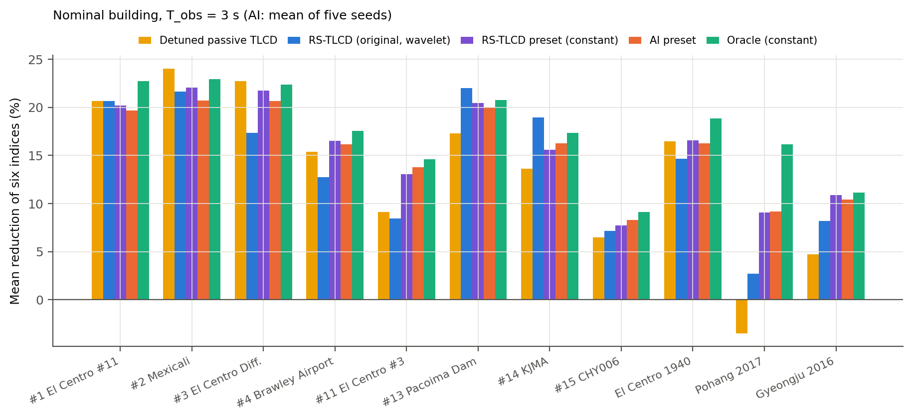
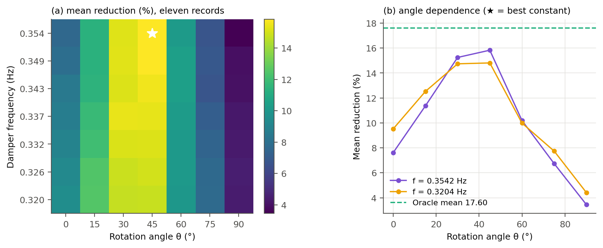
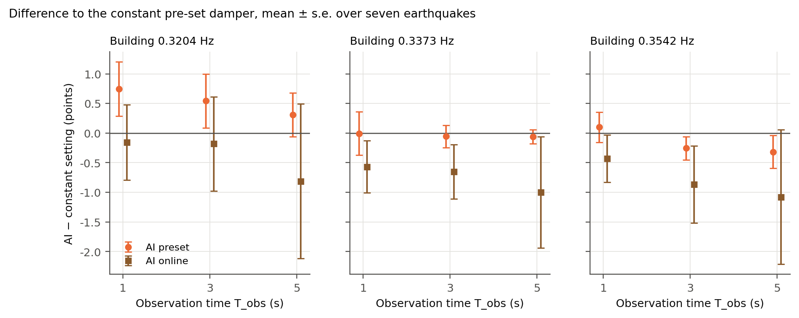

# 지진동 초기 정보로 회전형 반능동 동조액체기둥감쇠기를 미리 설정하기

(영문 제목: Pre-setting a rotating semi-active tuned liquid column damper from early ground motion)

> 읽기용 한글 번역본 (2026-10-23). 투고 원고는 영문 `논문_초안_v3.docx` / `.md`이며, 숫자·표·그림은 영문본과 같다. 영문본을 고치면 이 파일도 같이 고쳐야 한다.

박정주¹† (Jungju Park), 최윤식¹† (Yun Sik Choi), 정재훈¹* (Jae-Hoon Jeong)

¹ 국립군산대학교 임베디드소프트웨어학과 (Department of Embedded Software, Kunsan National University, Gunsan 54150, Republic of Korea)

† 공동 1저자 (두 저자가 동등하게 기여함), jungju3756@naver.com (박정주), dbstlr6676@naver.com (최윤식)
\* 교신저자: 정재훈, jh7129@kunsan.ac.kr

---

# 초록

회전형 반능동 동조액체기둥감쇠기(RS-TLCD)는 진동수, 회전판 각도, 오리피스를 조절해 이방향 편심 30층 건물을 제어한다. 그런데 원 제어법칙은 건물이 이미 응답한 뒤에야 진동수를 식별한다. 본 연구는 원 연구의 92자유도 건물을 회전 법칙을 원문 식 그대로 적용해 다시 구현하고, 감쇠기 진동수와 각도를 미리 정할 수 있는지, 그리고 지진동 처음 1–5초로 이를 예측하는 신경망이 고정 설정보다 나은지를 묻는다. 지진 7개의 기록 11개에서, 시험 지진을 빼고 고른 고정 설정은 원 로직보다 방향상 앞섰다(사건 단위 6지표 평균 저감률 +0.84 ± 1.24 ~ +1.31 ± 1.20 %p). 그러나 지진 7개로는 이 차이가 통계적으로 구분되지 않으며, 고정 설정에 장치보다 넓은 조절 범위를 허용하면 사라진다. 합성 및 실제 변형 샘플 2,000개로 학습한 신경망은 같은 지진 제외(leave-one-earthquake-out) 평가의 9개 조건 모두에서 고정 설정보다 낫지 않았고, 입력의 지배 진동수는 최적 감쇠기 진동수와 무관했다. 지진 도중 한 번 전환하는 방식은 사후 기준 3.65 %p의 여지가 있으나, 시험한 인과 규칙 16개 중 어느 것도 이를 실현하지 못했다. 이 결과는 현재 모델과 데이터로 보일 수 있는 것의 범위를 정한다.

**키워드:** 동조액체기둥감쇠기; 반능동 제어; 비틀림 연성; 신경망; 조기 지진동 정보; 같은 지진 제외 교차검증

# 1. 서론

질량과 강성이 편심된 고층 건물은 지진 시 두 수평 방향과 비틀림으로 동시에 응답한다. 수동 동조액체기둥감쇠기(TLCD)는 한 축으로만 작동하므로, 건물 진동수나 응답 방향이 설계 가정과 다르면 효과가 떨어진다. Fu 등(2025)은 30층 이방향 편심 건물에 회전형 반능동 TLCD(RS-TLCD)를 제안했다. 회전판이 액체 기둥을 응답 방향으로 돌리고, 펌프가 수위를 바꿔 감쇠기 진동수를 건물 진동수의 ±5% 안에서 조절하며, 오리피스가 감쇠를 바꾼다. 이들의 제어법칙은 건물이 움직이기 시작한 뒤 측정한 옥상 변위의 웨이블릿 변환으로 감쇠기 진동수와 각도를 정하고, 펌프와 회전판이 목표에 도달하는 데 시간이 더 걸린다. 따라서 감쇠기는 이미 일어난 운동만 따라갈 수 있다.

기계학습은 반능동 제어에 여러 방식으로 적용되어 왔다. Wang 등(2022)은 LSTM 앙상블을 사전 학습 없이 온라인으로 학습시켜 동조액체벽감쇠기의 오리피스를 구동했고, Kim과 Kim(2023)은 심층 Q-네트워크로 중간층 면진 시스템의 MR 감쇠기 전압을 지령했으며, AlHamaydeh 등(2024)은 지능형 감쇠 장치의 실시간 제어를 위해 직전 0.5초 창으로 지반가속도의 다음 1–200 샘플을 예측했다. Farsijani 등(2025)은 랜덤 포레스트로 지진동 특징과 동조질량감쇠기 성능의 관계를 분석해, 동조비가 가장 영향이 큰 변수이고 디튜닝 민감도가 지진동의 충격성에 따라 커짐을 보였다. 이 연구들은 측정 응답으로 액추에이터 지령을 조정하거나 파형 자체를 예측한다. 저자들이 아는 한, 구조물이 응답하기 전에 회전형 액체 감쇠기의 진동수와 각도를 설정한 연구는 없다.

본 연구는 지진동 초기 부분으로 감쇠기를 미리 설정할 수 있는지를 묻는다. 이는 진앙에서 멀리 떨어진 건물에서, 강진동이 도착하기 전에 다가오는 지진동 정보를 얻을 수 있는 상황에 해당한다. Fu 등(2025)의 건물, 감쇠기, 감쇠(오리피스) 법칙은 그대로 두고, 감쇠기 진동수와 회전판 각도를 고르는 방식만 바꾼다. 본 연구의 기여는 네 가지다.

1. 회전 법칙을 원문 식 그대로 적용한 92자유도 모델 재구현. 인쇄된 식이 감쇠기 진동수와 질량 투영을 연성시키며, 이 해석이 반능동 결과를 바꿈을 보인다(2, 3장).
2. 미리 설정해서 얻을 수 있는 몫의 분해: 고정 사전설정값, 지진별 최선 고정값(Oracle), 지진 중 한 번 바뀌는 설정(4장).
3. 지진동 처음 1–5초로 감쇠기 진동수와 각도를 예측하는 신경망. 합성 및 실제 변형 샘플 2,000개로 학습하고, 지진 7개의 기록 11개에서 같은 지진 제외 교차검증으로 평가한다. 입력의 지배 진동수를 추종하는 대안도 시험한다(5장).
4. 현재 모델, 데이터, 평가 절차로 보일 수 있는 것과 없는 것을 사건 단위 불확실성과 함께 제시(4–6장).

2장은 건물과 감쇠기, 3장은 지진동과 모델 검증, 4장은 기준 전략과 여지, 5장은 예측 신경망, 6장은 결론을 다룬다.

# 2. 대상 건물과 RS-TLCD 모델

## 2.1 이방향 편심 30층 건물

기준 구조물은 Fu 등(2025)의 30층 이방향 편심 골조이며, 제안 제어기를 원 제어기와 같은 조건에서 비교하도록 수정 없이 사용한다. 각 층은 두 수평 병진과 한 회전을 갖는 강체 바닥판이다. 층 질량과 질량 관성모멘트는 모든 층에서 m = 9.216 × 10⁵ kg, J = 2.797 × 10⁸ kg·m²이다. 수평 강성은 두 방향 모두 1층 1.021 × 10⁹ N/m, 나머지 층 1.6213 × 10⁹ N/m이고, 비틀림 강성은 각각 3.1651 × 10¹¹, 5.0261 × 10¹¹ N·m/rad이다. 질량 중심은 강성 중심에서 e_x = 6 m, e_y = 2 m 떨어져 있다. 고유 감쇠는 1, 2차 모드 2%의 Rayleigh 감쇠다. 건물과 감쇠기 파라미터는 표 1에 정리했다.

감쇠기 자유도를 더한 운동방정식은 다음과 같다.

$$
\mathbf{M}\ddot{\mathbf{U}} + \mathbf{C}(t)\dot{\mathbf{U}} + \mathbf{K}(t)\mathbf{U} = -\mathbf{M}\mathbf{E}\ddot{\mathbf{U}}_g \qquad (1)
$$

여기서 **U** = [u_x1 … u_x30, u_dx, u_y1 … u_y30, u_dy, u_θ1 … u_θ30]ᵀ는 92개 성분, **Ü**_g = [ü_xg, ü_yg]ᵀ는 이방향 지반가속도이며, **E**는 ü_xg를 모든 X 자유도(층과 감쇠기)에, ü_yg를 모든 Y 자유도에 배정한다. 병진–비틀림 연성은 **K**_xθ = e_y **K**_x, **K**_yθ = e_x **K**_y로 층 강성에서만 만든다(감쇠기 행은 회전과 연성되지 않음).

비제어 모델은 원 연구의 X 방향 고유진동수 10개(0.3373, 1.0112, 1.6831 … Hz)를 소수 넷째 자리까지 재현한다. 편심 때문에 X 1차 모드는 Y 1차 및 비틀림 모드와 연성되어 0.2714, 0.3373, 0.3953 Hz의 세 모드가 된다.

## 2.2 회전형 반능동 TLCD

RS-TLCD는 옥상 회전판 위에 놓인 U자형 액체 기둥이다. 고유진동수는 유효 액체 길이 L에만 의존한다.

$$
\omega_d = \sqrt{2g / L}, \qquad L = 2H_v + \lambda B \qquad (2)
$$

따라서 저수조 사이로 물을 펌핑하면 수직 수위 H_v, 곧 ω_d가 바뀐다. 원 설계를 따라 조절 범위는 1차 진동수의 ±5%인 [0.3204, 0.3542] Hz(L = 4.83–3.96 m)이고, 진동수 변경에 Δt_f = 2.6 s가 걸린다. 참여 액체 질량은 m_d = 694,767 kg(수동 TLCD 질량의 1.5배, 1차 모드 질량의 3%), 면적비는 λ = 0.237이다.

개구율 κ인 오리피스가 있는 수평부의 손실계수는

$$
\delta(\kappa) = (1-\lambda)^2 + 0.5|1-\lambda| + \lambda^2\left[(1-\kappa) + 0.707(1-\kappa)^{0.375}\right]^2 \kappa^{-2} \qquad (3)
$$

이며, 등가 선형 감쇠로 다음과 같이 들어간다.

$$
c_d(t) = \tfrac{1}{2}\,\rho\,\frac{A_v^2}{A_h}\,\delta(\kappa)\,|\dot u_d - \dot u_{n}| \qquad (4)
$$

회전판이 기둥 축을 θ(t)만큼 돌리므로 두 수평 방향의 등가 액체 질량은 m_dx = m_d cos θ, m_dy = m_d sin θ이고, 강성은 k_dx = m_dx ω_d² cos θ, k_dy = m_dy ω_d² sin θ이다(식 5, 3.2절). 따라서 각 축에 투영된 감쇠기 진동수는 ω_d√(cos θ), ω_d√(sin θ)이고, 방향별 질량의 합은 m_d(cos θ + sin θ)로 최대 √2 m_d가 된다. 회전 속도는 30°/s다.

**표 1.** 건물과 RS-TLCD 파라미터 (Fu 등 2025; 감쇠 보정은 2.4절).

| 항목 | 값 |
|---|---|
| 층수 / 자유도 | 30 / 92 (감쇠기 포함) |
| 층 질량 m, 질량 관성모멘트 J | 9.216 × 10⁵ kg, 2.797 × 10⁸ kg·m² |
| 수평 강성 (1층 / 나머지) | 1.021 × 10⁹ / 1.6213 × 10⁹ N/m |
| 비틀림 강성 (1층 / 나머지) | 3.1651 × 10¹¹ / 5.0261 × 10¹¹ N·m/rad |
| 편심 e_x, e_y | 6 m, 2 m |
| 고유 감쇠 | Rayleigh, 1·2차 모드 2% |
| 1차 진동수 (X) | 0.3373 Hz |
| 액체 질량 m_d, 면적비 λ | 694,767 kg, 0.237 |
| 진동수 조절 범위 | 0.3204–0.3542 Hz (±5%), L = 4.83–3.96 m |
| 진동수 변경 시간 Δt_f | 2.6 s |
| 회전 속도 | 30°/s |
| 오리피스 개구율 κ (c_min / c_opt / c_max) | 0.8 / 0.4 / 0.1, 1초마다 갱신 |
| 감쇠 보정 배율 | 30 (2.4절) |

## 2.3 원 제어법칙 (웨이블릿 식별)

원 RS-TLCD는 세 액추에이터를 옥상 응답 피드백으로 구동한다.

1. **진동수 (2.6초마다).** 각 방향 옥상 변위의 순간 진동수를 Morlet 웨이블릿 변환으로 식별해 조절 범위로 자르고, 변위 가중으로 합친다: ω_d = (|D_y|ω_dy + |D_x|ω_dx)/(|D_x| + |D_y|) [식 10–11]. 이후 펌프가 2.6초 동안 수위를 옮긴다.
2. **감쇠 (1초마다).** 두 방향 상대속도와 층 가속도의 부호에 따라 오리피스를 κ = 0.8, 0.4, 0.1 사이에서 전환한다 [식 12].
3. **각도 (2.6초마다).** 최근 t_R초 동안의 θ = arctan(D_y,max / D_x,max)로 회전판을 돌린다 [식 13].

진동수를 건물이 응답한 *뒤에* 식별하고 펌프가 2.6초를 더 쓰므로, 장치는 이미 일어난 운동에만 반응할 수 있다. 본 연구는 세 액추에이터와 감쇠 법칙(2번)을 그대로 두고, 목표 진동수와 각도(1, 3번)를 고르는 방식만 바꾼다.

## 2.4 수치해석과 모델링 가정

식 (1)은 Newmark 평균가속도법으로 Δt = 0.01 s 간격으로 적분한다. m_dx, m_dy, k_dx, k_dy, c_d가 시간에 따라 변하므로 **M**, **C**, **K**를 매 스텝 다시 조립한다. 웨이블릿 변환은 온라인 구현이 가능하도록 직접 구현했다(과거 샘플만 쓰는 인과적 반-Morlet 커널, 0.1–2 Hz, 80개 스케일). 툴박스 함수는 쓰지 않았다.

원 논문이 명시하지 않은 값이 있다. 다음 선택은 본 연구에서 비교하는 모든 제어기에 똑같이 적용했다.

- **단면.** A_v는 공칭 길이에서 m_d = ρA_vL로 구하고, A_h = A_v/λ로 둔다.
- **감쇠 속도.** 식 (4)는 감쇠기의 질량–스프링–대시포트 형태에 맞게 옥상에 대한 상대속도를 쓴다.
- **감쇠 보정.** 위 단면으로 식 (4)를 계산하면 등가 감쇠비가 0.05–0.5%에 불과하고, 일부 기록에서 수동 TLCD가 응답을 키운다. 그래서 식 (4)에 상수 30을 곱했다. 이 값은 수동 TLCD의 6지표 평균 저감률이 원 논문 표 7과 맞도록 정했다(15.56% 대 16.00%, X-RMS 33.19% 대 33.54%). δ의 κ 의존성(0.7–10배)은 유지되므로 반능동 감쇠 법칙은 여전히 작동한다(3장).
- **강성의 회전.** 원문 식을 그대로 적용한다(k_dx에 cos θ 두 번). cos θ를 한 번만 쓰는 경우와 감쇠기 질량을 보존하는 경우(cos² θ, sin² θ)는 3.2절에서 민감도 사례로 다룬다.
- **각도 창.** t_R = 2.6 s (각도 갱신 간격과 같음).
- **감쇠 수준.** c_min, c_opt, c_max는 κ = 0.8, 0.4, 0.1에 해당한다.

# 3. 지진동과 모델 검증

## 3.1 지진동

원 연구는 이방향 PEER 기록 15쌍을 썼다: 1979 Imperial Valley 지진의 관측소 12곳, Pacoima Dam(1994 Northridge), KJMA(1995 Kobe), CHY006(1999 Chi-Chi). 이 중 8쌍(원 논문 표 2의 1, 2, 3, 4, 11, 13, 14, 15번)은 원래 PEER 형식으로 구할 수 있었다. 나머지 7쌍은 한 성분이나 여진 기록만 있어 대체하지 않고 제외했다. 진동수 성분을 넓히기 위해 3쌍을 추가했다. El Centro 1940(N–S/E–W 성분, 공개 자료집에서 받았으며 보정된 PEER 버전과 같은지는 확인하지 않음)과, 기상청 광대역 속도계가 원거리에서 기록한 한국 중규모 지진 2개다(포항 2017, ML 5.4, KS.BUS2 관측소, 98 km; 경주 2016, ML 5.8, KS.CHJ2 관측소, 164 km). 한국 기록은 최대가속도가 1–3 cm/s²에 불과하며, 계기 감도로 속도로 변환한 뒤 미분하고 0.1–8 Hz로 대역통과했다. P파 도착 5초 전부터 60초를 쓴다. 원거리 기록이므로 스케일링 후 스펙트럼 성분이 다른 파형으로서만 쓴다. 4, 5장 평가에는 11쌍 모두를 쓰고, 아래 원 결과와의 비교에는 PEER 8쌍만 쓴다.

11쌍은 독립 지진 7개에서 나왔다. 그중 5쌍(1, 2, 3, 4, 11번)은 같은 Imperial Valley 지진의 관측소다. 이는 통계에 중요하다. 4, 5장에서는 학습할 때와 방법 간 차이를 평균할 때 모두 같은 지진의 기록을 한 묶음으로 다룬다.

원 연구를 따라 각 수평 성분을 최대지반가속도 35 cm/s²(중국 기준의 다빈도 지진 수준)로 스케일링한다. 원 논문은 성분별 스케일링인지 쌍별 스케일링인지 밝히지 않았다. 본 연구는 성분별 스케일링을 택했다.

**표 2.** 지진동 쌍. 스케일링 전 PGA는 각 기록 성분의 최댓값, 지배 진동수는 스케일링 후 0.1–5 Hz의 푸리에 진폭 최댓값 위치, Arias 구간은 X+Y 에너지 합의 5–95% 구간이다.

| 기록 | 지진 | 스케일링 전 PGA X/Y (cm/s²) | 지배 진동수 X/Y (Hz) | Arias 5–95% (s) |
|---|---|---|---|---|
| PEER 1 El Centro Array #11 | Imperial Valley 1979 | 360 / 372 | 4.12 / 3.78 | 6–15 |
| PEER 2 Aeropuerto Mexicali | Imperial Valley 1979 | 301 / 266 | 0.65 / 3.27 | 2–11 |
| PEER 3 El Centro Differential Array | Imperial Valley 1979 | 345 / 471 | 0.43 / 0.78 | 5–12 |
| PEER 4 Brawley Airport | Imperial Valley 1979 | 160 / 215 | 0.40 / 0.65 | 6–21 |
| PEER 11 El Centro Array #3 | Imperial Valley 1979 | 261 / 217 | 0.40 / 0.36 | 6–19 |
| PEER 13 Pacoima Dam | Northridge 1994 | 408 / 426 | 1.97 / 2.10 | 3–7 |
| PEER 14 KJMA | Kobe 1995 | 818 / 618 | 1.45 / 1.43 | 8–17 |
| PEER 15 CHY006 | Chi-Chi 1999 | 339 / 357 | 0.81 / 0.59 | 32–57 |
| El Centro 1940 | El Centro 1940 | 342 / 210 | 1.46 / 2.37 | 2–26 |
| 포항 2017 BUS2 | 포항 2017 | 2 / 1 | 2.83 / 2.79 | 8–37 |
| 경주 2016 CHJ2 | 경주 2016 | 3 / 3 | 1.11 / 1.33 | 24–37 |

11쌍의 스펙트럼은 그림 1과 같다. 0.1–5 Hz 대비 0.25–0.45 Hz(건물 진동수 0.337 Hz 부근) 에너지 비율은 0.6%(경주 2016), 0.7%(KJMA)에서 15%(Brawley Airport), 9%(El Centro Array #3)까지 분포한다.

## 3.2 RS-TLCD의 회전 법칙

원 연구의 식 (16), (17), (20)은 두 방향 등가 감쇠기 질량을 m_dx = m_d cos θ, m_dy = m_d sin θ로, X 방향 감쇠기 강성을 다음과 같이 준다.

$$
k_{dx}(t) = \frac{2\,m_{dx}\,g}{H_{vL}+H_{vR}+\lambda B}\cos\theta(t) = m_{dx}\,\omega_d^2\cos\theta(t) \qquad (5)
$$

따라서 강성에는 cos θ가 두 번(한 번은 m_dx를 통해) 들어가고, X축에 투영된 감쇠기 진동수는 ω_d가 아니라 ω_d√(cos θ)이다. 본 모델의 첫 버전(초안 v0)은 k_dx = m_dx ω_d², 곧 cos θ를 한 번만 썼다. 표 3은 이 해석이 반능동 결과에 영향을 줌을 보이며, 이번 초안부터 원문 식 (5)를 채택한다. 수동 TLCD와 S-TLCD는 회전하지 않으므로 영향이 없다.

**표 3.** 회전 법칙에 따른 RS-TLCD 재현 민감도: PEER 8쌍의 6지표 평균 저감률(%), 2.4절 감쇠 보정.

| 회전 법칙 | 수동 TLCD | S-TLCD | RS-TLCD | RS − 수동 |
|---|---|---|---|---|
| k = m_dx ω_d² (v0) | 15.56 | 15.43 | 15.31 | −0.25 |
| **식 (5), 원문 그대로 (채택)** | 15.56 | 15.43 | **16.12** | **+0.56** |
| 질량 보존형, m_dx = m_d cos²θ | 15.56 | 15.43 | 12.89 | −2.68 |
| *원 연구 (15쌍)* | *16.00* | *16.09* | *18.80* | *+2.80* |

원문 해석만이 반능동 결과를 원 결과 쪽, 곧 회전의 이점이 보고된 방향으로 옮긴다. m_dx = m_d cos θ, m_dy = m_d sin θ이면 두 방향 질량의 합이 m_d(cos θ + sin θ)로 45°에서 최대 √2 m_d가 되므로, 인쇄된 식은 액체 질량을 보존하지 않는다. 질량 보존형 투영은 원 RS-TLCD 결과를 훨씬 나쁘게 재현한다(12.89%). 이는 보고된 성능의 바탕이 질량 보존형이 아니라 인쇄된 식임을 시사한다. 원 제어기와 같은 식에서 비교하도록 인쇄된 식을 유지하고, 이 성질을 한계로 밝힌다. θ ≠ 0에서의 절대 저감률은 인쇄된 모델의 값으로 읽어야 한다.

## 3.3 검증

**고유진동수.** 비제어 모델의 X 방향 고유진동수 10개는 원 논문 표 1과 소수 넷째 자리까지 일치하고, 1차 모드 질량 참여율은 보고값과 같은 83.76%이다.

**수동 TLCD와 감쇠 보정.** 표 4는 6개 성능 지표(옥상 X, Y 변위와 옥상 회전의 최댓값과 RMS)의 평균 저감률을, 확보한 PEER 8쌍에 대해 원 논문 15쌍 평균과 비교한다. 2.4절의 보정 감쇠로 수동 TLCD는 원 평균 저감률을 가깝게 재현한다(15.56% 대 16.00%). 지배적인 X-RMS 지표도 같다(33.19% 대 33.54%).

**표 4.** 6지표 평균 저감률(%). 본 모델: PEER 8쌍, 원 연구: 15쌍.

| 사례 | 출처 | X 최대 | Y 최대 | θ 최대 | X RMS | Y RMS | θ RMS | 평균 |
|---|---|---|---|---|---|---|---|---|
| 수동 TLCD ×2 | 원 연구 | 15.39 | 11.45 | 9.85 | 33.54 | 14.33 | 11.43 | 16.00 |
|  | 본 모델 | 12.09 | 13.35 | 8.92 | 33.19 | 14.95 | 10.86 | 15.56 |
| S-TLCD ×2 | 원 연구 | 13.29 | 10.40 | 9.52 | 33.46 | 16.81 | 13.06 | 16.09 |
|  | 본 모델 | 9.72 | 12.03 | 6.61 | 35.46 | 17.43 | 11.35 | 15.43 |
| RS-TLCD | 원 연구 | 15.48 | 13.74 | 11.50 | 38.03 | 18.00 | 16.03 | 18.80 |
|  | 본 모델 (식 5) | 10.43 | 12.93 | 6.69 | 37.10 | 18.88 | 10.68 | 16.12 |

**한계.** 반능동 사례는 덜 재현된다. 원 연구에서 RS-TLCD는 수동 TLCD보다 평균 2.8 %p 낫지만, 본 모델에서는 0.56 %p(16.12% 대 15.56%)이고, RS-TLCD 평균이 원 결과보다 2.7 %p 낮다. 차이는 주로 최대값과 비틀림 지표에서 나온다(θ 최대 6.69% 대 11.50%, θ RMS 10.68% 대 16.03%). 가능한 원인은 보고되지 않은 단면(절대 감쇠 수준을 정함), 웨이블릿 식별의 세부, 위에서 논의한 회전 법칙, 누락된 기록 7개다. 기준선인 원 웨이블릿 법칙을 포함해 본 연구의 모든 제어기를 같은 모델과 같은 기록으로 평가하므로, 이 차이는 방법 간 순위보다 절대값에 더 영향을 줄 것으로 보인다. 그러나 모델 오차가 제어기마다 다르게 작용할 수 있어 보장할 수는 없다. 따라서 4, 5장의 결론은 현재 모델에 대한 것으로 서술한다.

# 4. 미리 설정해서 얼마나 얻을 수 있는가?

## 4.1 기준 전략

모든 전략은 원 감쇠 법칙(오리피스 전환, 1초)을 쓰고, 감쇠기 진동수 f와 회전판 각도 θ를 고르는 방식만 다르다. 성능 지표는 3장의 6지표 평균 저감률을 11개 기록에 대해 평균한 값이다. 전략은 표 5에 정리했다.

**표 5.** 4, 5장에서 비교하는 기준 전략.

| 이름 | 전략 | 지진을 알아야 하나? |
|---|---|---|
| E1b | 0.3204 Hz로 디튜닝한 수동 TLCD (회전 없음) | 아니오 |
| E2 | 원 RS-TLCD, 건물 응답 후 웨이블릿 식별 | 아니오 |
| 고정값 (Fixed) | t = 0부터 (f, θ) 한 칸으로 설정, 모든 지진에 같은 칸. 시험 지진을 뺀 학습 데이터(5.2절)에서 평균 라벨 점수가 가장 높은 칸 | 아니오 |
| Oracle | 기록마다 49칸(조절 범위 안 진동수 7개 × 각도 7개, 0–90°) 중 최선, t = 0부터 설정 | 예 — 실현 불가 |

Oracle은 *고정* 설정의 상한일 뿐이다. 지진 중 한 번 바뀌는 설정은 4.4절에서 다룬다.

## 4.2 결과

**표 6.** 11개 기록 평균 저감률(%). 건물 강성 ×0.9025, ×1, ×1.1025는 1차 진동수 0.3204, 0.3373, 0.3542 Hz(강성 저하 또는 증가)에 해당한다.

| 건물 | E1b | E2 | 고정값 | Oracle | 고정값 − E2 | Oracle − 고정값 |
|---|---|---|---|---|---|---|
| 0.3204 Hz (×0.9025) | 15.93 | 16.17 | 18.34 | 21.65 | 2.17 | 3.31 |
| 0.3373 Hz (×1) | 13.36 | 14.04 | 15.81 | 17.60 | 1.77 | 1.80 |
| 0.3542 Hz (×1.1025) | 13.32 | 13.25 | 14.78 | 15.99 | 1.53 | 1.22 |

두 가지 결과가 나온다.

1. **지진 전에 정한 고정 (f, θ)는 나중에 진동수를 식별하는 방식보다 방향상 앞선다.** 표 6의 고정값 칸은 시험 지진 없이(학습 데이터의 평균 라벨 점수 최고) 고르므로 실제로 배치할 수 있다. 기록 평균 고정값 − E2는 1.5–2.2 %p이지만, 지진 7개로 평균하면 +1.31 ± 1.20(공칭, 7개 중 5개 개선), +1.71 ± 1.52(0.3204 Hz, 7개 중 3개), +1.00 ± 0.67(0.3542 Hz, 7개 중 5개)이다. 칸을 다른 지진의 실제 기록으로 고르면 공칭 건물에서 +0.84 ± 1.24 %p(7개 중 5개)이다. 다른 회전 법칙(+1.52 ± 0.77, +2.20 ± 1.46)과 감쇠 배율(×20에서 +0.74 ± 1.05, ×40에서 +0.68 ± 1.18)에서도 부호는 같지만, 채택 모델에서 차이는 표준오차 하나 안이다. 원 장치는 ±5%를 유지하고 고정 설정에 ±20% 범위를 허용하면 차이는 −0.39 ± 0.70이다. 트리거 후 처음 8초 동안 고정 설정은 옥상 최대변위를 5.10% 줄이고 원 로직은 3.92% 줄인다. 이는 원 로직이 건물이 응답한 뒤에야 작동한다는 점과 일치한다.
2. **지진을 알면 1.2–3.3 %p를 더 얻는다** (Oracle − 고정값). 이는 지진마다 고정값 하나를 고르는 예측기가 얻을 수 있는 최대치다. 건물이 설계보다 무를 때 가장 크다(0.3204 Hz에서 3.3 %p).

Oracle은 49개 고정 칸 밖의 전략에 대해서는 상한이 아니다. 공칭 건물에서 진동수와 각도가 지진 중 바뀌는 원 RS-TLCD는 Pacoima Dam(22.01% 대 20.78%)과 KJMA(18.94% 대 17.35%)에서 Oracle을 넘고, 오리피스를 전환하지 않는 디튜닝 수동 TLCD는 Aeropuerto Mexicali(24.03% 대 22.95%)와 El Centro Differential Array(22.74% 대 22.38%)에서 Oracle을 넘는다(그림 4). 앞의 관찰은 시간에 따라 바뀌는 설정이 일부 기록에서 모든 고정 설정을 능가할 수 있음을 보이고(4.4절), 뒤의 관찰은 모든 RS-TLCD 전략이 공유하는 반능동 감쇠 법칙이 모든 기록에서 이로운 것은 아님을 보인다. 두 효과 모두 고정 (f, θ) 선택으로 회수할 수 있는 범위 밖이며, 4.3절의 여지에 포함하지 않는다.

그림 2는 El Centro 1940 기록의 옥상 응답이다. 제어된 변위는 비제어 스펙트럼의 정점인 1차 모드 진동수 부근에서 주로 줄고(그림 2b), 두 RS-TLCD 모두 6지표를 줄인다(그림 2c). 그림 3은 같은 해석에서 세 액추에이터의 움직임이다. 고정 설정은 진동수와 각도를 고정하고, 원 로직은 이미 일어난 응답에 맞춰 2.6초마다 바꾼다. 그림 4는 기록별 평균 저감률이다.

## 4.3 여지는 어디에 있나

공칭 건물에서 고정 칸을 11개 기록 자체로 고르면(고정 전략에 유리한 선택) 최선 고정값은 (0.3542 Hz, 45°)로 15.83%이고, Oracle은 17.60%로 여지는 1.77 %p이다.

- **진동수만** (θ는 최선값 고정): 0.73 %p. **각도만** (f 고정): 0.81 %p. 인쇄된 모델에서는 각 축에 투영된 감쇠기 진동수가 ω_d√(cos θ)이므로 두 값이 연성된다(3.2절). 최선 고정 진동수는 조절 범위의 상한이다.
- 평균 저감률은 각도에 크게 의존한다. θ = 0, 15, 30, 45, 60, 75, 90°에서 7.6, 11.4, 15.3, 15.8, 10.2, 6.7, 3.5%이다(f = 0.3542 Hz). Oracle 각도는 8개 기록에서 30°, 3개에서 45°이고, Oracle 진동수는 7개 기록에서 상한이다.
- 여지는 고르게 분포하지 않는다. 최선 고정 칸의 Oracle 대비 손실은 포항 2017 7.4 %p, El Centro Array #11 2.5, El Centro 1940 2.1, KJMA 2.0, El Centro Array #3 2.0, Pacoima Dam 1.3, Brawley 1.0, CHY006 0.8, 경주 0.4, Mexicali와 Differential Array 0이다. 기록 하나(포항 2017)가 평균 여지의 큰 부분을 차지한다.

**주의.** θ = 45°에서 인쇄된 모델은 각 방향에 0.71 m_d의 액체 질량과 ≈ 0.84 ω_d의 진동수를 주므로, 최선 고정값은 감쇠기를 건물 진동수보다 낮게 디튜닝한다. 이는 인쇄된 식 (5)의 성질이며(3.2절) 설계 권고가 아니다.

그림 5는 49개 고정 설정 전체의 11개 기록 평균 저감률이다.

## 4.4 지진 중 한 번 바뀌는 설정

미리 아는 정보를 쓰는 방법이 고정 설정만은 아니다. 강진동 동안 대기 상태(0.3373 Hz, 0°)로 두었다가 나중에 전환하는 감쇠기는 성능이 다를 수 있다. 대기 상태에서 칸 (f, θ)로 시각 t_s에 한 번 전환하는 경우를 평가하고, 전환 규칙마다 49칸을 탐색했다.

*트리거(0.5 gal) 후 고정 지연으로 전환.* t_s = 트리거 + 8초이면 최선 고정 칸이 17.18%에 이르고(t = 0부터 고정이면 15.83%), 칸과 지연에 대한 기록별 최댓값은 19.48%로 최선 고정값보다 3.65 %p 높다. 같은 칸에서 이득은 Imperial Valley 관측소 3곳과 Pacoima Dam에 몰려 있다(8초에서 Differential Array +9.2, Mexicali +5.8, Pacoima +2.8, Brawley +1.7 %p). 반면 El Centro Array #11(−0.5), KJMA(−6.0), El Centro 1940(−0.4), 경주(−1.8)는 손해이고 포항은 변화가 없다.

*실현 가능하고 일반화되는가?* 이 기록들에서 강진동은 트리거 후 2–25초에 시작하므로, 트리거 후 지연은 물리적 기준이 아니다. 그래서 과거 지반가속도만 쓰는 인과 규칙을 시험했다. 강진동 시작(지금까지의 최댓값 ≥ 0.1 m/s², 스케일링 최댓값의 약 30%) 후 지연, 누적 최댓값이 마지막으로 갱신된 뒤 경과 시간, 2초 평균제곱 가속도가 누적 최댓값 대비 감소한 정도다. 칸은 학습 지진에서만 고르고 제외한 지진에서 평가했다(같은 지진 제외, 지진 7개, Imperial Valley 기록은 한 묶음).

**표 7.** 전환 규칙, 공칭 건물. 사후: 11개 기록 전체에서 고른 최선 칸. 고정 설정 대비 차이: 지진 7개 평균 ± 표준오차.

| 규칙 | 사후 (%) | 고정 설정 대비 차이, 같은 지진 제외 (%p) | 개선된 지진 |
|---|---|---|---|
| t = 0부터 고정 | 15.83 | — | — |
| 트리거 + 8초 | 17.18 | +0.16 ± 1.45 | 4/7 |
| 트리거 + 12초 | 16.38 | +0.03 ± 0.81 | 3/7 |
| 트리거 + 24초 | 11.24 | −3.63 ± 1.10 | 1/7 |
| 강진동 시작 + 5초 | 16.80 | +0.18 ± 1.20 | 5/7 |
| 강진동 시작 + 8초 | 16.63 | −0.22 ± 1.17 | 3/7 |
| 2초 에너지가 최대의 50%로 감소 | 17.12 | −0.11 ± 1.32 | 4/7 |
| 5초 동안 최댓값 갱신 없음 | 17.33 | +0.01 ± 1.48 | 3/7 |
| 16개 중 교차검증으로 고른 최선 규칙 | — | −0.89 ± 1.06 | 2/7 |

어떤 규칙도 불확실성을 넘어 고정 설정보다 낫지 않다. 기록당 1.4–2.3 %p의 표본 내 차이는 주로 한 지진(Imperial Valley, 11개 중 5개 기록)과 Pacoima Dam에서 나온다. 그 지진을 빼면 나머지 지진에서 고른 고정 칸도 그 지진에서 성능이 나쁘다(Differential Array에서 12.0%, 최선 칸은 22.4%). 따라서 기록 단위 비교는 차이를 과장한다. 너무 늦은 전환은 해롭다(트리거 + 16초에서 −1.2 %p, + 24초에서 −3.6 %p). **따라서 시간 가변 여지는 인과 규칙으로 실현하지 못한 상한으로 보며, 주장하지 않는다.**

## 4.5 요약과 한계

- 고정 사전설정 감쇠기는 원 사후 식별보다 방향상 앞선다(기록 평균 1.5–2.2 %p, 공칭 건물 지진 단위 +1.31 ± 1.20 및 +0.84 ± 1.24, 고정값 선택 방식 두 가지). 그러나 지진 단위에서 차이가 구분되지 않는다.
- 지진을 완벽히 알면 지진마다 고정값 하나를 고를 때 1.2–3.3 %p를 더 얻는다. 여지는 소수의 기록에 몰려 있다.
- 이 값은 현재 모델의 값이다(3.3절). RS-TLCD 재현은 원 결과보다 2.7 %p 낮고, Oracle은 지진 7개의 기록 11개로 평가했다. 전략 간 약 1 %p 미만의 차이는 구분할 수 없다.
- 고정 전략과 Oracle은 원 연구의 35 cm/s² 스케일링을 쓴다. ±20% 조절 범위는 원문 회전 법칙으로 다시 계산했으며(4.2절), 원 장치 대비 고정 설정의 이점이 사라진다.

# 5. 지진동 초기 부분으로 감쇠기 설정 예측

## 5.1 문제

학습 과제는 트리거 후 처음 T_obs초의 지진동으로 3장의 저감률이 최대가 되도록 고정 감쇠기 설정 (f, θ)를 고르는 것이다. 이는 다가오는 지진동의 진동수가 아니라, 가장 좋았을 설정을 예측하는 문제로 정의한다. 두 가지는 최선 설정이 지진의 진동수 성분으로 정해질 때만 일치하는데, 4.3절은 이것이 일부만 성립함을 보인다(최선 고정값은 조절 범위 상한이고, 각도가 진동수만큼 중요하다).

## 5.2 학습 데이터와 라벨

샘플 하나는 이방향 지진동과 건물 강성 배율 k ∈ [0.81, 1.21](1차 진동수 ±10%)로 이루어진다. 각 샘플에는 4.1절의 49개 고정 설정을 모두 해석해 얻은 평균 저감률 7 × 7 맵을 라벨로 붙인다(샘플당 49회 해석). 신경망은 맵에서 샘플 평균을 뺀 값을 학습하므로, 최선 칸을 잘못 예측해도 좋은 이웃 칸을 고르는 경향이 있다.

- 합성 지진동 1,489개: 백색잡음에 Kanai–Tajimi 스펙트럼과 Clough–Penzien 고역통과 필터 적용, 지반 진동수 0.5–8 Hz(로그 균등), 지반 감쇠 0.2–0.6, 지속시간 15–40초, Jennings형 포락선, X–Y 상관 0–0.6, 세기 비 0.5–1.
- 실제 기록 변형 511개: 수평 회전 0–180°, 시간 스케일링 0.7–1.4(지배 진동수를 옮김).
- 모든 샘플은 성분별 35 cm/s²로 스케일링하고 자유진동 10초를 붙인다.

## 5.3 입력과 모델

입력(69개 값)은 트리거(0.5 gal) 후 처음 T_obs초로 계산한다. 각 수평 성분의 0.1–5 Hz 기하 간격 32개 대역 로그 푸리에 진폭(최댓값으로 정규화, 64개), X 최대가속도의 로그와 Y/X 최대값 비, 두 성분 주축의 sin 2φ와 cos 2φ, 건물 1차 진동수의 상대 변화(상시진동으로 안다고 가정)다. 모델은 완전연결 신경망 69–64–64–(49), ReLU, AdamW(학습률 2 × 10⁻³, 가중치 감쇠 10⁻³), 라벨 맵에 대한 평균제곱 손실, 400 에폭이며, 1/7 검증 분할에서 손실이 가장 낮은 에폭을 쓴다. 하이퍼파라미터 탐색은 하지 않았다.

## 5.4 평가 절차

- **같은 지진 제외.** 시험 기록마다 같은 지진의 모든 기록과 그 변형을 학습 집합에서 뺀다(Imperial Valley 관측소 5곳은 한 묶음). 시드마다 신경망 11개를 학습한다.
- **고정 기준선.** 고정 칸은 같은 학습 집합에서 평균 라벨 점수가 가장 높은 칸이므로, 신경망과 똑같이 배치 가능하다.
- **학습 시드 5개.** 시드 변동은 지진 간 변동과 따로 보고한다.
- **예측 적용 방식 두 가지.** *Preset*: 예측 칸을 t = 0부터 적용한다. 조기경보나 다른 사전 정보가 처음 T_obs초를 준 것처럼 가정한 이상화다. *Online*: 감쇠기는 대기 상태(0.3373 Hz, 0°)에 있다가 트리거 + T_obs에 지령을 받고, 원 설계의 펌프(2.6초)와 회전판(30°/s) 동특성을 따른다.
- T_obs = 1, 3, 5초; 건물 0.3204, 0.3373, 0.3542 Hz.
- 방법 간 차이는 지진 7개로 평균하고, 지진 간 평균 ± 표준오차로 보고한다.

## 5.5 결과

**표 8.** 11개 기록 평균 저감률(%). AI 열: 시드 5개 평균 ± 표준편차. 고정값, E2, Oracle 값은 표 6에 있다. 마지막 두 열: 고정 설정 대비 차이(%p), 지진 7개 평균 ± 표준오차.

| 건물 (Hz) | T_obs (s) | AI preset | AI online | Preset − 고정값 | Online − 고정값 |
|---|---|---|---|---|---|
| 0.3204 | 1 | 18.29 ± 0.30 | 17.76 ± 0.30 | +0.74 ± 0.46 | −0.16 ± 0.64 |
|  | 3 | 18.42 ± 0.70 | 18.48 ± 0.53 | +0.55 ± 0.45 | −0.18 ± 0.80 |
|  | 5 | 18.28 ± 0.31 | 18.34 ± 0.31 | +0.31 ± 0.37 | −0.81 ± 1.30 |
| 0.3373 | 1 | 15.21 ± 0.25 | 14.89 ± 0.25 | −0.01 ± 0.37 | −0.57 ± 0.44 |
|  | 3 | 15.58 ± 0.25 | 15.64 ± 0.15 | −0.06 ± 0.19 | −0.65 ± 0.46 |
|  | 5 | 15.55 ± 0.16 | 15.87 ± 0.17 | −0.06 ± 0.12 | −1.00 ± 0.94 |
| 0.3542 | 1 | 14.56 ± 0.15 | 14.25 ± 0.11 | +0.10 ± 0.26 | −0.43 ± 0.40 |
|  | 3 | 14.46 ± 0.26 | 14.62 ± 0.27 | −0.26 ± 0.20 | −0.87 ± 0.65 |
|  | 5 | 14.79 ± 0.27 | 15.34 ± 0.14 | −0.32 ± 0.28 | −1.08 ± 1.14 |

9개 조건 평균은 고정 설정 대비 +0.11 %p(preset), −0.64 %p(online)이며, 개선 폭이 표준오차를 뚜렷이 넘는 조건은 없다. 가장 큰 +0.74 ± 0.46 %p도 표준오차 2배 안이고 9개 비교 중 하나다. 지진 대신 기록으로 평균하면 차이는 −0.18, −0.17 %p이고, preset이 고정값보다 나은 기록은 조건에 따라 11개 중 2–8개다.

추가 관찰:

- **신경망은 고정값 이상의 여지를 회수하지 못한다.** 고정 설정만으로 E2와 Oracle 사이 간극의 40–56%를 회수한다(2.7–5.5 %p 중 1.5–2.2 %p, 기록 평균; 지진 단위 불확실성은 4.2절). preset 신경망은 같은 간극의 33–56%를 회수한다(표 9). 결과를 원 방법 대비 "Oracle 이득 회수율"로 표현하면, 고정값도 주는 이득을 신경망의 공으로 돌리게 된다.
- **신경망은 고정값보다 정보가 많았는데도 이득이 없었다.** 고정 칸은 모든 건물 상태의 학습 라벨에서 한 번 고르지만, 신경망은 건물 진동수 변화를 입력으로 받는다(5.3절). 건물 상태를 안다는 것도 더 나은 (f, θ) 선택으로 이어지지 않았다.
- **관측 시간은 체계적 영향이 없다.** 같은 건물에서 1, 3, 5초의 preset 결과는 최대 0.4 %p 차이(예: 공칭 건물 15.21, 15.58, 15.55%)로 시드 표준편차(0.1–0.7)와 비슷하며, T_obs에 따라 단조 증가하지 않는다. 기록으로 평균하면 online과 preset은 0.6 %p 안이지만, 지진으로 평균하면 online은 9개 조건 모두에서 고정 설정보다 낮다(−0.16 ~ −1.08 %p). Oracle 칸의 진동수는 모든 T_obs에서 6–15 mHz, 곧 34 mHz 조절 범위의 18–43% 오차로 예측된다.
- **겉보기 이득 하나는 Oracle 정의의 부산물이다.** 강한 건물, T_obs = 5초에서 online은 기록 평균으로 고정값보다 +0.57 %p이지만 지진 평균으로는 −1.08 ± 1.14 %p이다. 기록 평균은 El Centro Differential Array가 좌우하는데, 여기서는 늦은 전환이 고정 설정의 Oracle마저 넘는다(26.9% 대 17.3%). 이는 4.4절의 늦은 전환 효과이며 지진 간에 일반화되지 않는다.
- **한국 기록.** 무른 건물에서 신경망은 포항과 경주에서 고정값보다 1.4–2.0 %p 높고(preset, 두 기록 평균), 다른 두 건물 상태에서는 ±0.3 %p 안이다. 기록 두 개이므로 시드와 기록 간 변동과 구분할 수 없다. 포항은 여지도 가장 크다(4.3절).

**표 9.** 원 RS-TLCD(E2)와 Oracle 사이 간극 중 각 전략이 메우는 비율(기록 평균, AI = 시드 5개 평균). 간극 = Oracle − E2 (%p).

| 건물 (Hz) | 간극 | 고정값 | AI preset (1/3/5 s) | AI online (1/3/5 s) |
|---|---|---|---|---|
| 0.3204 | 5.48 | 40% | 39 / 41 / 38% | 29 / 42 / 40% |
| 0.3373 | 3.56 | 50% | 33 / 43 / 42% | 24 / 45 / 51% |
| 0.3542 | 2.75 | 56% | 48 / 44 / 56% | 36 / 50 / 76% |

고정값은 지진 정보 없이 간극의 40–56%를 메운다. online의 76%(강한 건물, 5초)는 위에서 논의한 사례로, 지진 단위에서는 고정값 대비 −1.08 ± 1.14 %p가 된다.

그림 6은 표 8을 지진 단위로 요약한다.

## 5.6 고찰

결과는, 지진동 1–5초 정보로 신경망이 고정 설정보다 나은 설정을 고르지 못했다는 것이다. 세 가지 이유를 들 수 있으나 어느 것도 증명되었다고 주장하지 않는다.

1. **해상도.** 1–5초 창의 스펙트럼 해상도(0.2–1 Hz)는 조절 범위 전체(0.034 Hz)와 건물 진동수 자체보다 거칠어서, 창의 진동수 성분으로는 범위 안의 설정을 구분할 수 없다. 입력 FFT에 추가한 진동수 점은 스펙트럼을 보간할 뿐 정보를 더하지 않는다.
2. **여지는 예측하기 어려운 것에 달려 있다.** 이전 버전 모델에서, 모의 지진 1,000개(Boore 2003 확률론적 방법)의 규모, 거리, 지반 등급을 신경망에 주어도 5겹 검증에서 Oracle 여지를 전혀 회수하지 못했다. 그때 여지는 조기경보 파라미터에 담기지 않는 위상과 응력강하 변동에서 생겼다. 이 실험은 현재 모델로 다시 하지 않았다.
3. **기록당 여지가 작다.** 일부 기록(포항 2017)을 빼면 좋은 고정값의 Oracle 대비 손실은 0–2.5 %p로 시드 간 변동과 같은 크기다. 따라서 합성 샘플 2,000개로 학습하고 기록 11개로 평가한 신경망은 유의한 이득을 보일 수 없다.

이 결과는 본 연구의 구조, 데이터, 평가에 한정된다(합성 및 회전 실제 기록으로 학습한 작은 신경망, 하이퍼파라미터 탐색 없음, 후회 기반이나 순환 모델 없음, 지진 7개의 시험 기록 11개). 예측으로 인한 이득이 여기서 입증되지 않았음을 보일 뿐, 존재할 수 없음을 보이는 것은 아니다.

## 5.7 다가오는 지진동의 진동수를 추종하는 해석

감쇠기를 다가오는 진동에 맞춘다는 목적에서 나올 수 있는 다른 정식화는, 지진동의 지배 진동수를 예측해 감쇠기 진동수를 그에 맞추는 것이다. 현재 모델에서는 데이터가 이 해석을 지지하지 않는다. 감쇠기는 건물 진동수의 ±5%(0.3204–0.3542 Hz) 안에서만 움직이는데, 11개 기록의 지배 진동수는 약 0.2–4.1 Hz에 걸쳐 있으므로(성분별 값은 표 2), 예측된 입력 진동수는 거의 항상 범위의 한쪽 끝으로 잘린다. 표 10은 기록마다 Oracle의 최선 고정 진동수(4.1절)와 입력의 스펙트럼 지표 세 가지의 관계를 보인다.

**표 10.** 기록의 최선 고정 감쇠기 진동수와 입력 스펙트럼 지표 사이의 순위상관(Spearman). 기록 11개(n = 11)와 지진 7개(n = 7, Imperial Valley 기록은 평균)로 계산. n = 7에서 |ρ|의 5% 임계값은 약 0.79, n = 11에서는 약 0.62.

| 입력 지표 (0.1–5 Hz) | ρ, 기록 11개 | ρ, 지진 7개 |
|---|---|---|
| 푸리에 진폭 최댓값의 진동수 | −0.31 | −0.20 |
| 스펙트럼 중심 | −0.66 | −0.63 |
| 0.1–5 Hz 대비 0.25–0.45 Hz 에너지 | +0.01 | +0.12 |

지배 진동수와 건물 진동수 부근 에너지는 최선 감쇠기 진동수와 무관하다. 스펙트럼 중심은 음의 부호, 곧 고주파 성분이 많은 기록이 낮은 감쇠기 진동수를 선호하는데, 이는 입력 진동수 추종과 반대다. 독립 지진 7개로는 유의하지 않다(|ρ| = 0.63 < 0.79). 11개 중 7개 기록의 최선 진동수가 범위 상단(0.3542 Hz)인 것은 입력 스펙트럼보다 식 (5)의 f–θ 연성(4.3절)을 반영한다. 따라서 신경망이 가장 좋았을 감쇠기 진동수와 각도를 고르는 5.1절의 정식화를 유지한다. 오리피스(밸브) 법칙은 예측하지 않고 원 법칙을 그대로 쓴다(2.3절).

## 5.8 한계

- 지진 7개의 기록 11개. Imperial Valley 기록 5개는 독립이 아니고, 한국 기록은 2개뿐이다.
- 라벨은 감쇠기 질량을 보존하지 않는 원문 회전 법칙 식 (5)에 의존한다(3.2절). RS-TLCD 재현은 원 결과보다 2.7 %p 낮다(3.3절).
- Preset 적용은 이상화다. 실제 조기경보 적용에는 전송, 계산, 구동 시간도 고려해야 한다.
- 건물 강성 배율은 안다고 가정했다. 원 연구의 강건성 시험처럼 입력에 잡음을 넣는 경우는 검토하지 않았다.
- 신경망은 원 설계의 조절 범위(±5%)로만 학습하고 평가했다. ±20% 범위는 고정 설정에 대해서만 검토했다(4.2절).

# 6. 결론

본 연구는 Fu 등(2025)의 92자유도 이방향 편심 30층 건물과 회전형 반능동 TLCD를 회전 법칙을 인쇄된 그대로(식 (5), 원 연구의 식 (20)) 다시 구현하고, 감쇠기 진동수와 회전판 각도를 강진동 전에 정할 수 있는지를 물었다. t = 0부터 고정하고 시험 지진 없이 고른 고정 설정은 6지표 평균 저감률에서 원 웨이블릿 기반 로직보다 앞섰다. 다른 지진의 실제 기록으로 고르면 +0.84 ± 1.24 %p, 학습 라벨로 고르면 +1.31 ± 1.20 %p였고, 두 경우 모두 지진 7개 중 5개에서 우세했다. 표 3의 다른 두 회전 법칙(+1.52 ± 0.77, +2.20 ± 1.46 %p)과 감쇠 보정 배율 20, 40(+0.74 ± 1.05, +0.68 ± 1.18 %p)에서도 부호가 같았고, 트리거 후 처음 8초 동안 고정 설정은 원 로직보다 옥상 최대변위를 조금 더 줄였다(5.10% 대 3.92%). 이는 원 로직이 건물이 응답한 뒤에야 작동한다는 점과 일치한다. 그러나 지진 7개로는 채택 모델에서 차이가 표준오차 하나 안이고, 고정 설정에 ±20% 조절 범위를 허용하면 사라졌다(−0.39 ± 0.70 %p). 따라서 입증된 이득이 아니라 경향으로 보고한다.

지진동 처음 1–5초로 설정을 예측하는 신경망은 같은 지진 제외 평가에서 고정 설정보다 신뢰할 만한 이득을 보이지 않았다. 9개 조건 모두에서 사건 단위 표준오차가 차이보다 컸다. 과제를 다가오는 지진동의 진동수 추종으로 보는 해석도 지지되지 않는다. 입력의 지배 진동수는 최선 감쇠기 진동수와 무관했고(Spearman ρ = 기록 11개에서 −0.31, 지진 7개에서 −0.20), 감쇠기는 건물 진동수 주위 ±5%만 움직일 수 있다. 지진 중 한 번 설정을 바꾸는 방식은 사후 기준 약 3.65 %p의 여지를 보였으나, 시험한 인과 전환 규칙 중 어느 것도 같은 교차검증에서 이를 실현하지 못했다. 이 결과는 현재의 구조·데이터·절차에서 예측의 이득이 입증되지 않았다는 것이지, 예측이 불가능하다는 것이 아니다.

주요 한계는 원 RS-TLCD 결과와 남은 약 2.7 %p의 차이, 단일 건물 모델, 지진 7개의 기록 11개, 보정 감쇠 배율 30, 센서 잡음 시험의 부재다.

# 참고문헌

(영문본과 같음. 서지는 원어 그대로 둔다.)

AlHamaydeh, Tellab and Tariq (2024), "Deep-learning-based strong ground motion signal prediction in real time", *Buildings*, **14**(5), 1267. https://doi.org/10.3390/buildings14051267

Farsijani, Gholam, Karampour and Talebian (2025), "Machine-learning based performance assessment of TMD-equipped buildings subjected to near-field pulse-like ground motions", *Journal of Building Engineering*, **105**, 112380. https://doi.org/10.1016/j.jobe.2025.112380

Fu, Wang, Wang, Xue and Xie (2025), "Rotating semi-active tuned liquid column damper for bi-directional eccentric structural seismic response control", *Journal of Building Engineering*, **103**, 112205. https://doi.org/10.1016/j.jobe.2025.112205

Kim and Kim (2023), "Development of a control algorithm for a semi-active mid-story isolation system using reinforcement learning", *Applied Sciences*, **13**(4), 2053. https://doi.org/10.3390/app13042053

Wang, Ubertini and Laflamme (2022), "Ensemble of long short-term memory recurrent neural network for semi-active control of tuned liquid wall damper", *Engineering Structures*, **270**, 114771. https://doi.org/10.1016/j.engstruct.2022.114771

> 미완: Boore (2003), Kanai–Tajimi, Clough–Penzien, Jennings 서지 추가 필요. 저자 이니셜 확인 필요.
